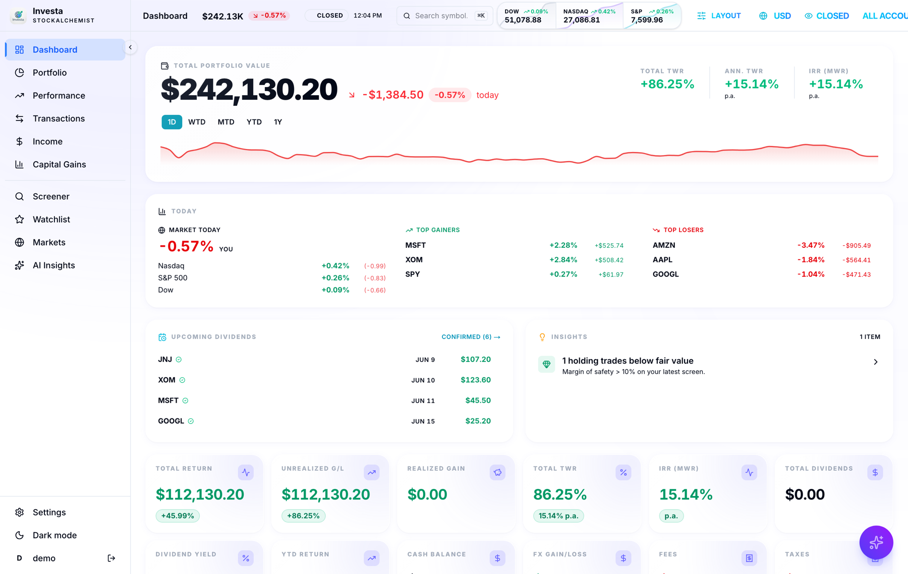
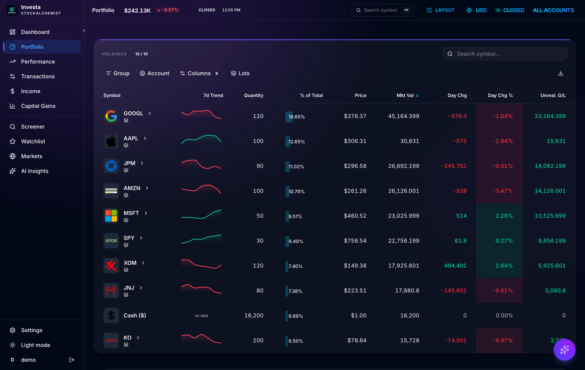
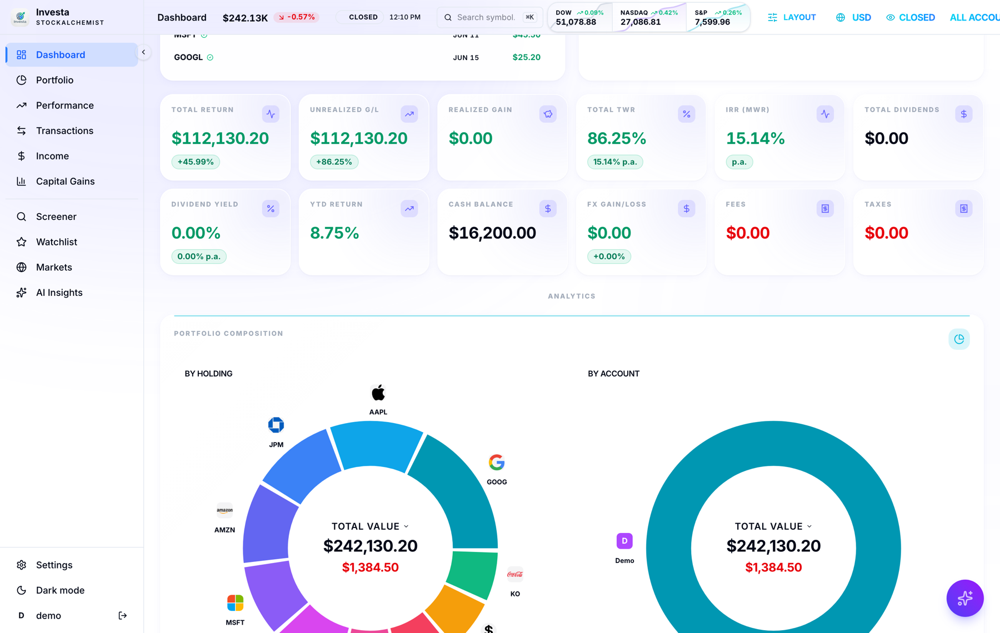
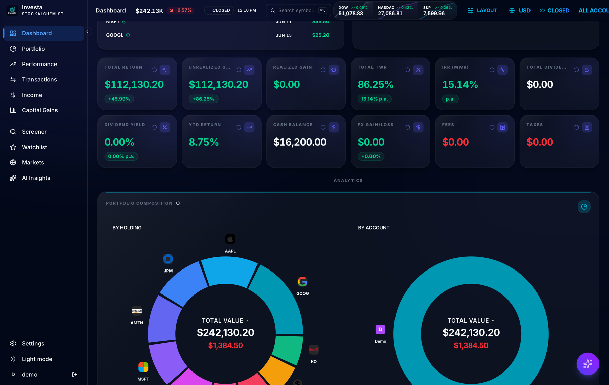
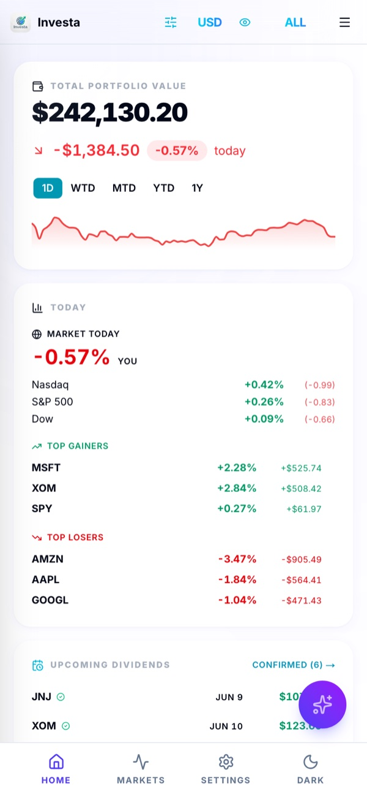

# Investa Portfolio Dashboard v1.1

[](https://opensource.org/licenses/MIT)

Investa is a comprehensive portfolio management solution with a modern **Web Dashboard**. It helps you track, analyze, and visualize your investment portfolio using a local SQLite database for complete data privacy.

## Features

* **Secure Data:** Local SQLite database for full privacy.
* **Portfolio Summary:** Real-time net value, gains/losses (realized & unrealized), dividends, and TWR.
* **Comprehensive Holdings:** Sortable table with detailed metrics for stocks, ETFs, and cash.
* **Transactions:** Direct database editing, CSV import/export, and full history log.
* **Multi-Currency:** converting all assets to your preferred display currency (e.g. USD, EUR, JPY).
* **Performance Charts:** Time-Weighted Return (TWR) vs. Benchmarks (SPY, QQQ) and Portfolio Value over time, including **gapless intraday views** (1D, 5D) with **intelligent caching** for instant after-hours loading.
* **Interactive Price Charts:** Detailed stock price charts with **Moving Averages (SMA 50/200)**, configurable time ranges (1D to Max), and gain/loss shading, plus optional **overlays** for your buy/sell transactions (with realized gain/loss shown in sell tooltips), dividend payouts, earnings dates, and benchmark comparison lines.
* **Dividend Tracking:** Charts and tables for annual/quarterly/monthly dividend income, including **forward-looking Annual Yield %** metrics.
* **Advanced Analysis:** Asset allocation, Correlation Matrix, Factor Analysis, and Scenario Analysis.
* **Rebalancing:** Calculator to help you rebalance portfolio to target allocations.
* **Web & Mobile:** Sleek Web Dashboard with mobile-optimized navigation, market indices, and a **comprehensive Market Screener**.
* **Apple Ecosystem:** Native client application for **macOS, iOS, and iPadOS** written in SwiftUI. It connects to the Investa backend to provide a seamless, high-performance native experience with real-time charts and dynamic portfolio views.
* **Market Screener:** identify opportunities across your Watchlist, Holdings, or the **entire database ("All Stocks")** with quantitative intrinsic value filters.
* **AI Score:** Intelligent **scorecard-based rankings** in the Watchlist and Screener to help prioritize high-probability investments.
* **Buffett/Value Rankings:** A batch pipeline ranks US-listed stocks on a **quality-value composite** computed from **SEC EDGAR** filings (~19 years of filed fundamentals per company, not a 5-year vendor window), and stores dated snapshots you can screen and sort.
* **Model Strategies:** Six rule-based model portfolios built on that ranking — from **Buffett Quality 20** (the default) through tighter, uncapped, large-cap-only and quality-value blends — each shipping its **backtested CAGR, volatility, max drawdown and Sharpe** over 2013-2025, its **training vs. held-out** returns, and a plainly stated list of **its own risks**.
* **Custom Groups (Tags):** Organize holdings with custom tags (e.g., "Core", "Speculative") for personalized grouping.
* **Contribution Analysis:** See exactly how much each holding contributes to your total portfolio return.
* **Customizable Layouts:** A **Layout Configurator** on every tab lets you toggle and arrange widgets (including "Sector Contribution" and "Top Contributors") to build your own views; your layout persists across sessions.
* **Fundamental Data:** Built-in viewer for company profiles, financials, and balance sheets.
* **Intrinsic Value Analysis:** Twelve valuation models — **DCF**, **D-CFO**, **D-NI**, **DDM**, **Graham**, **EPV**, **Peter Lynch**, **PEG**, **PSG**, and historical **P/E / P/B / P/S** multiples — of which a **business-aware subset is blended** into one fair value (free cash flow for operating companies, net income for financials, cash flow and distributions for REITs), each weighted by its own **Monte Carlo** uncertainty. Ships a **confidence score**, a **bear/bull range**, an **earnings-power floor**, **NAV for ETFs**, **currency normalization** — and a **refusal** where the fundamentals cannot support a valuation, in place of a fabricated number.
* **AI Portfolio Review:** Intelligent AI-powered analysis of your portfolio holdings, providing personalized insights, risk assessments, and diversification suggestions.
* **Data Robustness:** Built-in **Ticker Normalization** (e.g., mapping `BRK.B` to `BRK-B`) and sanitization to prevent batch-fetch failures.
* **User Authentication:** Secure login and registration system with multi-user support.
* **HTTPS Support:** Built-in Tailscale Serve configuration for secure, encrypted access on local networks and mobile devices.
* **Valuation Overrides:** Every model input (growth, discount rate, base cash flow, multiples) is adjustable from sliders in the stock's Valuation tab, re-blending the fair value live; per-symbol defaults can also be pinned in `manual_overrides.json`.
* **Batch Valuation:** The Market Screener values whole universes (S&P 500, Russell 2000, "All Stocks") in the background and caches the result, so a screen over thousands of symbols reads from a shared store rather than recomputing.
* **IBKR Integration:** Automated syncing of transactions from Interactive Brokers via Web Flex Service with a staging area for review and approval.
* **Brokerage Statement Import:** Import transactions directly from **PDF / image statements** — deterministic parsers for **Interactive Brokers** and **Webull**, plus an AI fallback for other brokers — with an import-review step that flags already-imported rows to prevent duplicates.
* **Annualized Performance:** Key metrics like **IRR (MWR)** are clearly labeled as **"Ann."** when displayed as annualized returns for better clarity.
* **Interactive Donut Charts:** The Portfolio tab features large, fully interactive allocation donut charts (by Asset Type, Sector, Geography, Industry) with hover-to-highlight slices and an inline legend showing value and percentage.
* **Allocation Drift Alerts:** Set a target allocation per group (e.g., 60% Sector/Technology) via the Portfolio tab. Live drift cards show how far each slice has moved from its target, colour-coded by severity, and persist across sessions.
* **Tax-Lot View:** The Capital Gains tab now includes a **short-term vs. long-term** lot summary with a ranked table of **tax-loss harvesting candidates**, wash-sale warnings, and a "ripening" section for short-term lots graduating to long-term within 30 days.
* **Custom Benchmark Tickers:** Add any valid ticker (e.g., `VT`, `TQQQ`, individual stocks) as a custom benchmark in the Performance graph alongside the built-in presets.
* **Enhanced Fundamentals (FMP Fallback):** For stocks that yfinance misclassifies — including foreign companies listed on US exchanges as ADRs — a Financial Modeling Prep (FMP) enrichment layer correctly identifies the domicile country, sector, and industry.
* **Collapsible Sidebar & Search:** The web app navigation is a collapsible sidebar. Press **⌘K** (or Ctrl+K) at any time to open a symbol search palette for quick stock lookups without leaving the current view.
* **News Feed:** A dedicated **Markets** tab aggregates general market news alongside per-stock news, accessible directly from the sidebar.

## Getting Started

For a step-by-step guide on setup, usage, and configuration, please see our detailed tutorial:

➡️ **[Investa User Tutorial](TUTORIAL.md)**

## Screenshots

<div align="center">
  <table>
    <tr>
      <td align="center">
        <b>Dashboard Light Theme</b><br>
        
      </td>
      <td align="center">
        <b>Holdings Dark Theme</b><br>
        
      </td>
    </tr>
    <tr>
      <td align="center">
        <b>Allocation Light Theme</b><br>
        
      </td>
      <td align="center">
        <b>Allocation Dark Theme</b><br>
        
      </td>
    </tr>
    <tr>
      <td align="center">
        <b>Mobile View</b><br>
        
      </td>
    </tr>
  </table>
</div>

## Technology Stack

* **Web:** Next.js, React, Tailwind CSS, FastAPI
* **Data:** pandas, NumPy, sqlite3, yfinance
* **Analysis:** SciPy, Numba, statsmodels

## Installation

Requires **Python 3.11+** (SciPy 1.16 needs 3.11, Numba 0.61 needs 3.10) and
**Node 20.9+** for the web app (Next.js 16). Developed and tested on Python
3.12 and Node 22.

1. **Clone the Repository**

    ```bash
    git clone https://github.com/StockAlchemist/Investa.git
    cd Investa
    ```

2. **Create Virtual Environment**

    ```bash
    python3 -m venv venv
    source venv/bin/activate  # Windows: .\venv\Scripts\activate
    ```

3. **Install Dependencies**

    ```bash
    pip install -r requirements.txt
    ```

4. **Install Web App (Optional)**

    ```bash
    cd web_app && npm install && cd ..
    ```

5. **Add API Keys (Optional)**

    Create a `.env` file in the project root. Investa runs without it — only
    the features listed below go dark — and the file is gitignored, so your
    keys stay local.

    ```bash
    GEMINI_API_KEY=...     # AI Review, AI Score, AI statement import
    FMP_API_KEY=...        # fundamentals fallback for misclassified/ADR tickers
    TIINGO_API_KEY=...     # alternative price source
    AUTH_SECRET_KEY=...    # JWT signing; auto-generated if unset
    CORS_ALLOW_ORIGINS=... # extra origins, comma-separated
    INVESTA_LOG_LEVEL=...  # default WARNING; INFO or DEBUG when debugging
    ```

    Without `GEMINI_API_KEY` the AI panels return "GEMINI_API_KEY not found"
    and everything else — holdings, performance, valuation, the screener and
    the ranking — works normally.

## Updating an existing installation

Stop the backend before adding the transaction receipt table. The migration
creates a SQLite backup beside each portfolio database and can be run repeatedly.
It preserves transactions and allows web/macOS/iOS submissions to be retried
without adding duplicate trades or cash entries.

```bash
python scripts/migrate_transaction_receipts.py --dry-run
python scripts/migrate_transaction_receipts.py
```

New portfolios include the receipt table automatically. Existing portfolios need
this migration before transaction submissions from the updated clients work.

Pending IBKR transactions offer an account selector on each row before approval.
Individual, selected, and bulk approval use each row’s chosen account across web,
macOS, and iOS; unchanged rows retain their imported account.

The original dashboard uses portfolio and metric cards with a separate performance
chart. The compact default keeps detailed analytics behind an explicit control.
Saved redesign defaults return to the original layout; custom layouts are retained.
Holdings offer Overview, Performance, Income and Valuation presets. The header's
"Calculated" time comes from the backend calculation rather than browser arrival.
Web URLs preserve the selected section, currency, accounts and stock; native apps
can share and open equivalent `investa://open` links.

For repeatable latency measurements, `scripts/benchmark_dashboard.py` reports
first-request and warm median/p95 timings plus payload sizes, without printing
portfolio contents. Set `INVESTA_BENCHMARK_TOKEN` in your environment and run it
against your backend. A first request is cold only when server caches are cold;
the script does not clear caches or write portfolio data. Responses also expose
`Server-Timing`, and `INVESTA_LOG_LEVEL=DEBUG` logs request durations.

To compare revisions without provider/network variance or touching user data,
build and serve each web revision on a separate port, then run:

```bash
cd web_app
node scripts/benchmark-comparison.cjs http://127.0.0.1:3112 http://127.0.0.1:3113 /tmp/browser-comparison.json 5
```

The runner alternates versions, uses fresh browser storage, blocks service workers,
and intercepts every API call with identical fixtures and a 120 ms response delay.
It measures the same portfolio hero in each version, counts GET requests and
uncompressed API response bodies over ten seconds, and checks both default and
saved compact layouts. These are controlled replay results, not live-market latency.

For backend scheduling, run `scripts/benchmark_runtime_comparison.py --source
/path/to/revision/src --output /tmp/backend-comparison.json --samples 15` with the
project's Python environment. Only cached history is substituted (5,040 deterministic
daily observations); actual risk and backtest calculations run through the routes.
The scheduled probe reports completion delay relative to its intended arrival,
including event-loop blocking. No server lifespan/background jobs or real databases
are started. Compare output hashes as well as timings before drawing conclusions.

The [12 Oct 2026 comparison results](docs/benchmarks/runtime_comparison_2026-10-12.json)
include every measured sample and the baseline commit. The default dashboard made
29 versus 13 GET requests (55% fewer) and received 102,210 versus 66,339 bytes of
uncompressed API bodies (35% less). First hero value medians were 1.193 versus
1.080 seconds; the fully settled animated figure was 2.050 seconds in both.
With a saved compact layout, the updated first-value median was slightly slower
(1.103 versus 1.035 seconds), so initial loading did not improve consistently.
Browser timing ranges overlap and each scenario has only five runs per version.
Across 45 backend repetitions per version, the backtest median was 156.453 versus
161.382 ms; the scheduled probe delay fell from 152.597 to 1.881 ms. Analytics
outputs matched exactly. This demonstrates lower request/payload volume and
better scheduling responsiveness, not faster financial math or live provider calls.

## Quick Usage

**Run the full stack (backend on :8000, frontend on :3000):**

```bash
./start_investa.sh
```

*See the [Tutorial](TUTORIAL.md) for detailed usage instructions.*

## HTTPS Configuration (Highly Recommended)

Investa includes a built-in configuration tool to secure your app with HTTPS using Tailscale Serve. this is **required** for proper autofill functionality on mobile devices and secure remote access.

1. **Ensure Tailscale is installed and running.**
2. **Run the configuration script:**

    ```bash
    ./enable_https.sh
    ```

3. **Use the provided HTTPS URL** (e.g., `https://your-node.ts.net`) to access the dashboard.

## Configuration & Data

Everything Investa owns lives in a `data/` directory beside the code, so a
backup is a copy of one folder and moving an installation is moving it:

```text
data/
├── users/<username>/
│   ├── portfolio.db              your transactions, holdings and cash — the data
│   └── config/
│       ├── gui_config.json       layout, display currency, benchmarks
│       └── manual_overrides.json per-symbol valuation and metadata overrides
├── db/
│   ├── global.db                 accounts, sessions, cross-user settings
│   ├── market_data.db            cached prices and fundamentals
│   ├── edgar_facts.db            SEC XBRL fundamentals (~800 MB when built)
│   └── buffett_ranks.db          ranking snapshots
├── config/
│   └── auth_secret.key           signs session tokens (auto-generated)
├── screener/screener_cache.db    shared screener valuations
├── exports/                      CSV exports
└── cache/                        derived caches, safe to delete
```

Each user gets their own `portfolio.db`; nothing is shared between accounts
except the market and screener caches.

**What to back up.** Two things cannot be regenerated:

* `users/` — every account's transactions, layout and overrides.
* `db/global.db` — the account registry itself, usernames and password hashes.
  Lose it and the portfolios survive but nobody can log in to reach them.

Keep `config/auth_secret.key` too if you can: it signs session tokens, so
replacing it costs no data but logs everyone out. The rest genuinely is
derived — `market_data.db`, `edgar_facts.db`, `buffett_ranks.db`, `screener/`
and `cache/` all rebuild themselves, slowly the first time and normally after.

For details on `gui_config.json`, `manual_overrides.json`, and input formats,
consult the **[Tutorial](TUTORIAL.md#configuration-persistence-gui_configjson--manual_overridesjson)**.

## Input Data Format (CSV)

Investa supports importing transaction history from CSV.

* **Key Fields:** `Date`, `Type`, `Symbol` (`$CASH` for cash), `Quantity`, `Price/Share`, `Account`.
* **Format:** See **[Tutorial: Input Data Format](TUTORIAL.md#part-1-getting-set-up)** for the detailed specification.

## Troubleshooting

Common issues regarding market data loading or CSV imports are addressed in the **[Tutorial: Tips & Troubleshooting](TUTORIAL.md#part-12-tips--troubleshooting)**.

## Contributing

Issues and pull requests are welcome on
[GitHub](https://github.com/StockAlchemist/Investa). Run `pytest tests/` and
`ruff check src/` before opening one; the CI workflow runs the backend tests,
the frontend build, Playwright E2E and an API type-drift check.

## License

MIT License. See [LICENSE](LICENSE).

## Author

* **Google Gemini and Claude**
